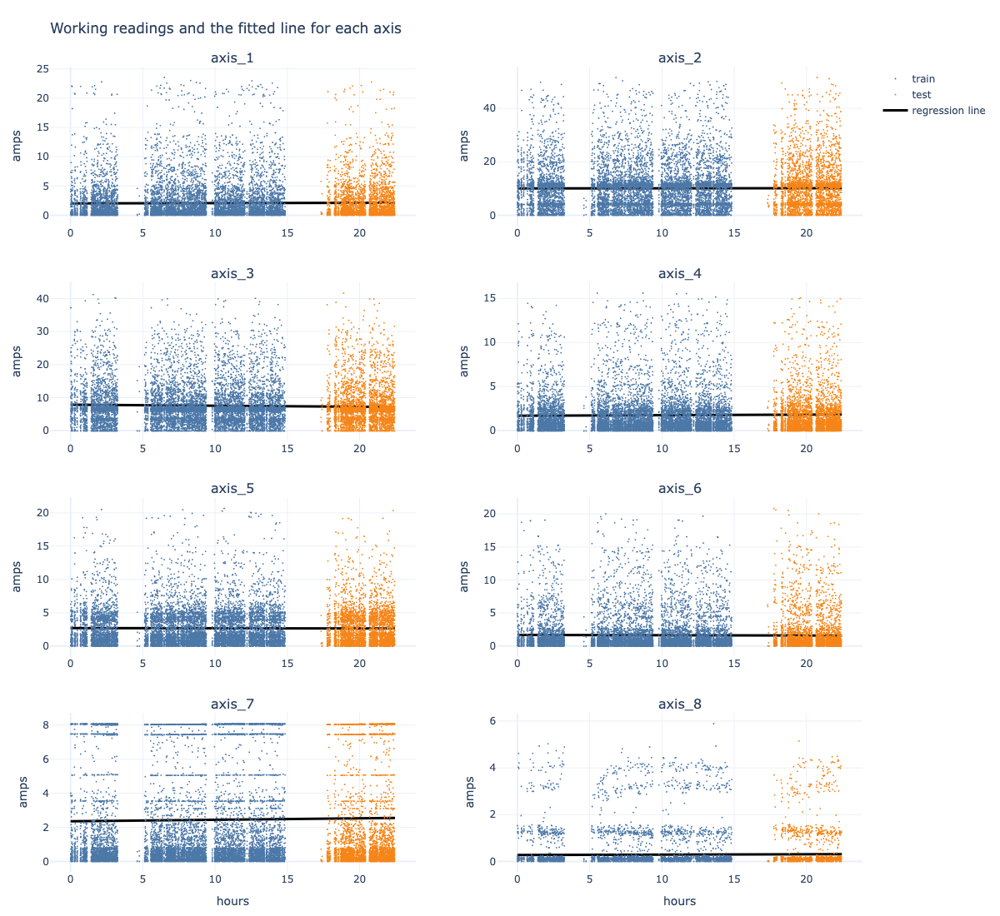
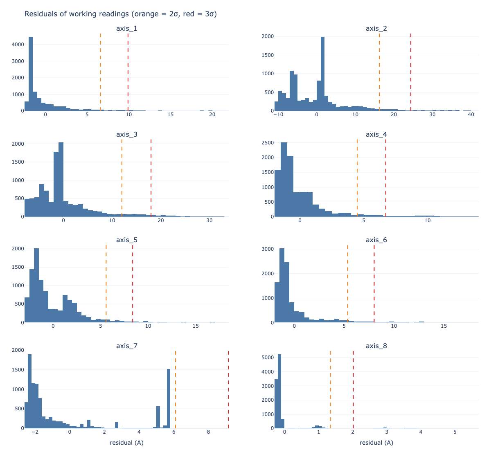
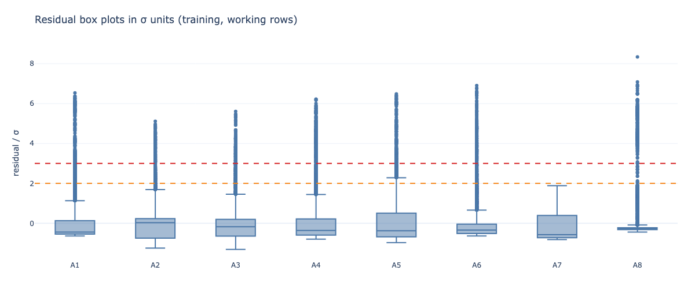
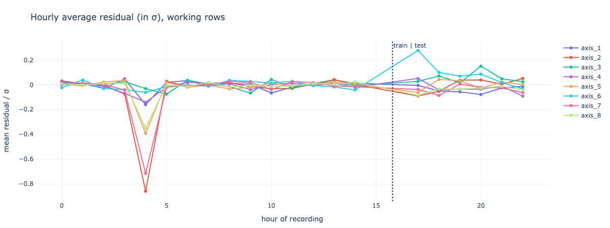
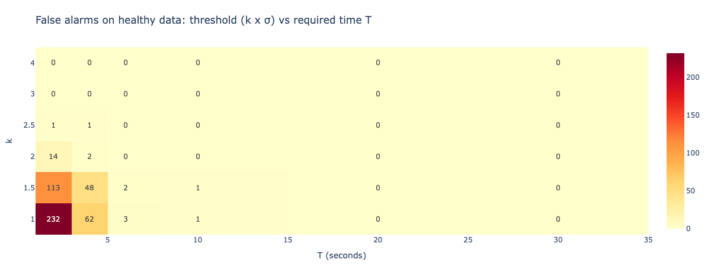
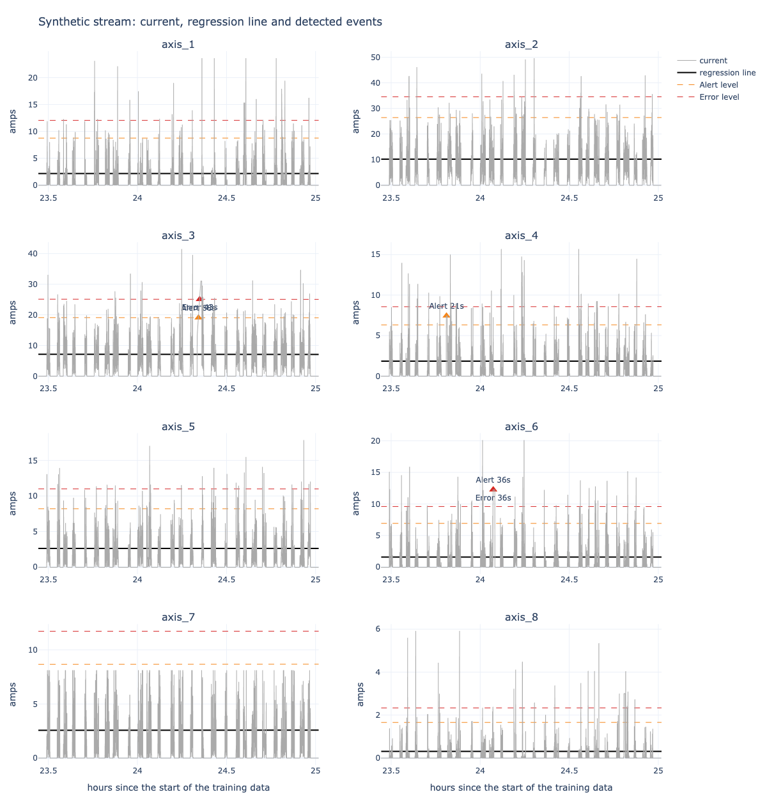
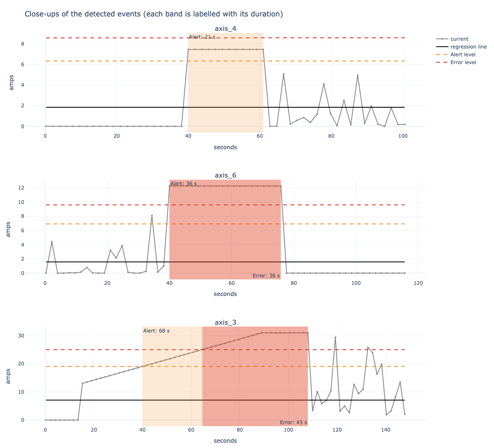

# Catching Overworked Robot Joints with Linear Regression

| | |
|---|---|
| **Course** | CSCN8010 — Foundations of Machine Learning Frameworks |
| **Author** | Carlos Gutierrez |
| **Student ID** | 9118309 |

A predictive-maintenance project. One straight-line model per robot axis learns how much current
that joint normally draws. The gap between the real current and the line (the residual) is used to
set Alert and Error rules, which are then tested on a synthetic data stream sent through a cloud
PostgreSQL database (Neon).

## Contents

1. [Project summary](#project-summary)
2. [Results at a glance](#results-at-a-glance)
3. [Repository layout](#repository-layout)
4. [Setup](#setup)
5. [How it works](#how-it-works)
6. [Alert and Error rules](#alert-and-error-rules)
7. [Plots](#plots)
8. [Limitations](#limitations)

## Project summary

The training data (`data/RMBR4-2_export_test.csv`) has **39,672 readings** from one robot, taken
about every 1.9 seconds over 22.5 hours (17–18 October 2022). Each reading gives the current, in
amperes, of eight joints (Axis #1–#8).

What the notebook does:

1. Pulls the training data from the Neon `robot_readings` table.
2. Fits one linear regression per axis (time → current).
3. Studies the residuals (histograms, box plots, hourly averages, outlier counts).
4. Finds MinC, MaxC and T by testing which settings stay quiet on healthy data.
5. Generates synthetic test data from the training statistics and plants known faults in it.
6. Streams the test data through Neon in batches, predicts each value and detects Alerts/Errors.
7. Logs every event to `results/events.csv` and to the Neon `alert_events` table.
8. Plots the regression lines with Alert/Error markers labelled with their duration.

> **Units.** The assignment describes the thresholds in kWh. The file only has current (amps), with
> no voltage, so energy can't be calculated. All thresholds are in **amps above the regression
> line**.

## Results at a glance

| | |
|---|---|
| Alert rule | current ≥ **MinC** above the line for ≥ **10 s** without a break |
| Error rule | current ≥ **MaxC** above the line for ≥ **10 s** without a break |
| MinC | 2 × σ of the axis residuals |
| MaxC | 3 × σ of the axis residuals |
| Real healthy data (22.5 h) | **0** Alerts, **0** Errors |
| Synthetic stream | 2,995 readings through Neon; 6 of 6 planted faults handled correctly; 0 false alarms |
| Events logged | 5 (3 Alerts, 2 Errors), all from planted faults |

## Repository layout

```text
.
├── LinearRegression_Alerts.ipynb       # main notebook, saved with the output of its last run
├── DataStreamVisualization_Workshop.ipynb  # earlier group workshop (Neon + streaming)
├── README.md
├── requirements.txt                    # pinned dependencies
├── pyproject.toml                      # project metadata and dependencies
├── data/
│   ├── RMBR4-2_export_test.csv         # training data (also loaded into Neon)
│   └── synthetic_test.csv              # generated test stream
├── results/
│   ├── model_parameters.csv            # intercept, slope and R² per axis
│   ├── residual_summary.csv            # σ, skew and outlier shares per axis
│   ├── threshold_sweep.csv             # false alarms for each threshold and duration
│   ├── selected_thresholds.csv         # σ, MinC, MaxC and T per axis
│   ├── synthetic_vs_training_check.csv # normalization / z-score comparison
│   ├── fault_check.csv                 # planted faults vs what the rules found
│   ├── events.csv                      # logged Alert/Error events
│   └── plots/                          # PNG charts and interactive HTML versions
└── src/
    ├── data_collection/
    │   ├── data_collection_agent.py    # Neon connection and queries
    │   └── streaming_simulator.py      # replays a CSV one reading at a time
    ├── database-service/
    │   └── migrate_schema.py           # loads the training CSV into Neon
    └── web_ui/                         # live dashboard (Dash) from the workshop
```

## Setup

**Requirements:** Python 3.13, plus a Neon PostgreSQL database (the free tier is enough).

1. Install the dependencies: `pip install -r requirements.txt`
2. Create a file named `.env` in the project root with the connection string from the Neon console
   (`.env` is git-ignored):

   ```text
   DATABASE_URL=postgresql://<user>:<password>@<host>/<database>?sslmode=require
   ```

3. Open `LinearRegression_Alerts.ipynb` (start Jupyter from the project root so the relative paths
   resolve) and choose **Run → Run All Cells**.

## How it works

### Regression models (Time → Axis #1–#8)

The data is split in time order: the first 70% for training and the last 30% for testing. About
64% of the rows are **idle** (all axes exactly 0 while the robot is parked). Fitting through those
zeros would drag every line down, so the lines are fitted on **working rows only**. Idle rows are
still checked later, but their residual is negative so they can't raise an alert.

| Axis | Intercept (A) | Slope (A per hour) |
|---|---|---|
| 1 | 2.006 | +0.0055 |
| 2 | 10.003 | +0.0065 |
| 3 | 7.839 | −0.0313 |
| 4 | 1.676 | +0.0069 |
| 5 | 2.694 | −0.0029 |
| 6 | 1.683 | −0.0043 |
| 7 | 2.359 | +0.0087 |
| 8 | 0.272 | +0.0017 |

R² is about 0 for every axis. A healthy robot's average load does not trend over a day, so each
line settles at that joint's typical working current. That shows there is no drift, not that the
model failed.

### Residual analysis

Residual = real current − predicted current (positive means "drawing more than expected").

- **Histograms:** every axis leans to the right. The robot works in cycles, so short bursts of
  high current are normal.
- **Box plots (in σ units):** most points sit close to the line, and the outliers are all high.
- **Outliers:** about 4–6% of working readings are above 2σ and about 2–3% above 3σ (axis 7 tops
  out at 8.1 A and has none). Size alone can't tell a fault from normal work, so the rules also
  require **duration**.
- **Hourly averages:** flat around 0, with no climb in the test part.

### Synthetic test data

The stream is generated in the notebook with a fixed seed:

1. For each axis, standardized values (mean 0, SD 1) are drawn from a skewed Gamma shape.
2. They are turned back into amps with the **training** mean and SD, and clipped to the training
   min and max.
3. The robot is idle in blocks, with about the same idle share as the training data.
4. Six faults are planted, each with a known right answer:

| Fault | Axis | What is planted | Expected |
|---|---|---|---|
| short spike | 2 | 4σ for 3 readings (4 s) | nothing |
| mild overload | 4 | 2.5σ for 12 readings | Alert |
| strong overload | 6 | 4σ for 20 readings | Alert + Error |
| slow climb | 3 | 1σ → 4σ over 40 readings, then holds | Alert, then Error |
| interrupted | 1 | 4σ ×4, one normal reading, 4σ ×4 | nothing |
| recording gap | 8 | 4σ ×4, 5 readings missing, 4σ ×4 | nothing |

To check the data looks like the training data, the working rows are min-max scaled with the
training min/max and turned into z-scores with the training mean/SD. The means, SDs and the shares
of readings within ±1, ±2 and ±3 SD are close to training (`results/synthetic_vs_training_check.csv`).
Axis 7 is the weakest match because its real values are capped at 8.1 A.

### Streaming through Neon

`StreamingSimulator` hands out the readings of `synthetic_test.csv` one at a time. Every 50
readings are inserted into the `synthetic_test_readings` table and **queried back from the
database**. The model predicts the queried values and the detector updates its timers. The detector
keeps its state between batches, so a deviation that crosses a batch boundary is timed correctly.

The notebook then checks that the rows returned by Neon match the CSV, and that the live events
match an independent offline calculation.

## Alert and Error rules

### How the values were chosen

The 22.5 hours of real data are healthy, so the question was: which settings **never fire** on it?
The notebook tests thresholds of 1, 1.5, 2, 2.5, 3 and 4 × σ against required durations of 2 to 30
seconds and counts the false alarms (`results/threshold_sweep.csv`).

| Threshold | Longest healthy streak |
|---|---|
| 1 × σ | up to 11.4 s (axis 7), 4–6 s on several others |
| 1.5 × σ | up to 11.4 s (axis 7) |
| **2 × σ** | **5.6 s** (axis 6) |
| 2.5 × σ | 5.5 s (axis 6) |
| **3 × σ** | **2.0 s** (one or two readings) |
| 4 × σ | 0 (never reached) |

| Setting | Value | Why |
|---|---|---|
| **MinC** | 2 × σ per axis | Lowest level where healthy streaks stay below 6 s. |
| **MaxC** | 3 × σ per axis | Healthy data never stays here for more than 1–2 readings, so an Error is clearly worse than an Alert. |
| **T** | 10 seconds | Longer than every healthy streak at 2σ (5.6 s), but only about six readings in a row. |

| Axis | σ (A) | MinC (A) | MaxC (A) | T (s) |
|---|---|---|---|---|
| 1 | 3.30 | 6.60 | 9.90 | 10 |
| 2 | 8.13 | 16.26 | 24.39 | 10 |
| 3 | 6.00 | 11.99 | 17.99 | 10 |
| 4 | 2.24 | 4.48 | 6.73 | 10 |
| 5 | 2.79 | 5.58 | 8.37 | 10 |
| 6 | 2.67 | 5.34 | 8.01 | 10 |
| 7 | 3.05 | 6.10 | 9.15 | 10 |
| 8 | 0.67 | 1.35 | 2.02 | 10 |

If two readings are more than 5.7 s apart (three times the usual step), the timer restarts. A hole
in the data is not treated as proof of continuous overload.

### In predictive-maintenance terms

- A worn part or a binding joint **keeps** drawing extra current. That is a sustained deviation,
  which is what T looks for.
- **Alert** = inspect at the next planned stop. **Error** = stop and check now.
- The rules raise nothing on a healthy day, so maintenance staff have a reason to trust them when
  they do fire.
- Axes 2 and 3 carry the heaviest loads. Over weeks, a slope that starts climbing there would be
  the early sign of wear.

## Plots

**Eight regression lines** (training in blue, test in orange):



**Residual histograms** (orange = 2σ, red = 3σ):



**Residual box plots** (in σ units):



**Hourly average residual** (no drift):



**False alarms on healthy data for each threshold and duration:**



**Synthetic stream** with the regression lines, the Alert/Error levels and the detected events:



**Close-ups** of the detected events, each labelled with its duration:



Interactive HTML versions of every chart are in [`results/plots/`](results/plots/).

## Limitations

- **No fault labels.** The data has no confirmed failures, so precision and recall can't be
  measured. The thresholds are set to keep a healthy day quiet.
- **The test data is simplified.** It is built from per-axis statistics, so the joints don't move
  together like they do in real work cycles, and the planted faults are clean plateaus.
- **One day is short.** The models are a baseline. Slow wear would need weeks of data and regular
  refitting.
- **Recording stops.** The data has two long stops (around hours 3.5–5 and 15–17.5).
